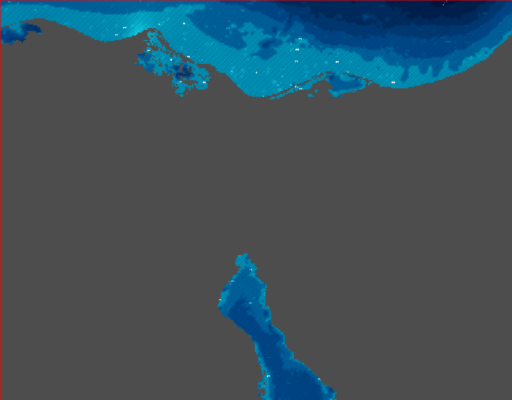

# i.ocean



A [GRASS GIS](https://grass.osgeo.org/) addon that renders the ocean areas
of a raster map with a realistic visual appearance.

Written in **C with OpenMP** and **FFTW3** spectral synthesis.  Given a
raster in which one cell value marks water (default `1`), the module
produces a styled, floating-point output raster with an automatically-tuned
ocean colour table.  Non-ocean pixels become null so the result composites
cleanly over any land base-map.

## Features

- **Five latitude-driven colour palettes** — from bright tropical turquoise to
  icy polar blue, auto-detected from the map centre or set explicitly.
- **Depth-based colour gradient** — accepts a bathymetric raster; falls back to
  shore-distance estimation (`-s`) or a flat mid-depth default.
- **Automatic integer depth smoothing** — when the depth map is integer type
  (CELL), a 3×3 neighbourhood average converts it to a continuous floating-point
  (DCELL) raster before normalisation, removing staircase artefacts.
- **Scale-aware wave textures** (`-w`) — sinusoidal wave patterns calibrated to
  the current pixel size across five scale tiers (sub-100 m ripples → 100 km
  gyre-scale undulations).
- **Phillips-spectrum turbulence + coastal foam** (`-f`) — FFTW3 computes a
  physically-based ocean surface via the Phillips power spectrum; foam appears
  at wave crests using a squared-excess threshold, amplified near the coast
  with an exponential decay factor derived from a two-pass Euclidean distance
  transform (Meijster 2000).
- **Maritime decorations** (`-d`) — 27 decoration types across three categories
  (sea life, war vessels, merchant ships) scattered proportionally to ocean area
  with reproducible seeded placement; each type is also exported as a GRASS
  vector map with real-world-scale polygon silhouettes and a per-type colour
  table.
- **North–south warmth gradient** (`-l`) — mimics the visible SST gradient
  within the scene by subtly shifting colour temperature equatorward to poleward.
- **Full CRS support** — geographic (degrees) and projected (metres, feet, km);
  pixel sizes are converted to metres internally.
- **Multi-core parallel processing** — OpenMP `#pragma omp parallel for` on all
  inner loops; uses `omp_get_max_threads()` automatically.
- **Progress reporting** — `G_percent()` at each named step, visible in the
  terminal and the GRASS GUI progress bar.

## Colour palettes

| Style | Latitude | Character |
|---|---|---|
| `tropical` | < 23.5° | Bright turquoise / cyan |
| `subtropical` | 23.5–35° | Warm blue-green |
| `temperate` | 35–60° | Clear cool blue |
| `subpolar` | 60–75° | Steel blue |
| `polar` | > 75° | Icy pale blue |

## Quick start

```sh
# 1. Create a land/sea mask (ocean = 1)
r.mapcalc "sea_mask = if(elevation < 0, 1, null())"

# 2. Basic render — auto palette, flat depth
i.ocean input=sea_mask output=ocean_view

# 3. With bathymetry, waves, and shore-depth fallback
#    Integer (CELL) depth maps are smoothed automatically
i.ocean input=sea_mask depth=gebco_bathy output=ocean_deep -w

# 4. Shore-estimated depth + latitude warmth gradient
i.ocean input=sea_mask output=ocean_rich -s -l

# 5. Phillips-spectrum turbulence with coastal foam
i.ocean input=sea_mask depth=gebco_bathy output=ocean_turbulent -f

# 6. Maritime decorations (sea life, war vessels, merchant ships)
i.ocean input=sea_mask depth=gebco_bathy output=ocean_deco -f -d

# 7. Full effect stack
i.ocean input=sea_mask depth=gebco_bathy output=ocean_full \
        style=tropical -w -f -l -d

# 8. Display the result
d.rast map=ocean_full
```

### Style-specific examples with decorations

`deco_scale` controls the vector silhouette size multiplier.  Merchant hulls
(140–300 m) need much less scaling than biological features (3–110 m) to remain
visible.  Use the rule of thumb `deco_scale ≈ region_extent_km × 0.4 / 300` as
a floor for 300 m hulls; multiply by 10–50 for cetaceans and small objects.

```sh
# tropical  — warm turquoise shallows; cargo ships and product tankers
#             dominate busy coastal lanes
i.ocean -w -s -d --overwrite \
    output=ocean_tropical depth=bathy@PERMANENT \
    style=tropical deco_scale=80

# subtropical — Mediterranean / Caribbean blue; full merchant fleet range,
#               LNG carriers visible in deeper offshore water
i.ocean -w -s -f -d --overwrite \
    output=ocean_subtropical depth=bathy@PERMANENT \
    style=subtropical deco_scale=100

# temperate — North-Atlantic grey-blue; heaviest traffic corridor
#             (container ships, bulk carriers, crude tankers)
i.ocean -w -s -f -d --overwrite \
    output=ocean_temperate depth=bathy@PERMANENT \
    style=temperate deco_scale=120

# subpolar  — cold steel-blue; LNG carriers prominent on Arctic routes;
#             fewer tropical fauna, wave texture without foam
i.ocean -w -d --overwrite \
    output=ocean_subpolar depth=bathy@PERMANENT \
    style=subpolar deco_scale=150

# polar     — icy pale blue; LNG and bulk carriers still placed (depth
#             range 30–500 spans most polar shelves); -f and -s omitted
i.ocean -w -d --overwrite \
    output=ocean_polar depth=bathy@PERMANENT \
    style=polar deco_scale=200

# display raster + vector decorations together
d.rast map=ocean_temperate
d.vect ocean_temperate
```

## Parameters

| Parameter | Type | Default | Description |
|---|---|---|---|
| `input` | raster | — | Ocean mask raster (cells equal to `ocean_value` are ocean) |
| `output` | raster | — | Output ocean visualisation raster |
| `depth` | raster | — | Bathymetric depth map (positive = metres below surface); integer maps are smoothed automatically |
| `ocean_value` | float | `1` | Cell value that marks ocean pixels in `input` |
| `depth_min` | float | `0` | Minimum depth value treated as ocean when deriving the mask from `depth`; use a negative value for DEM/elevation maps |
| `latitude` | float | auto | Reference latitude (decimal degrees, negative = south); auto-detected from map centre if omitted |
| `style` | string | `auto` | Colour style: `auto`, `tropical`, `subtropical`, `temperate`, `subpolar`, `polar` |

## Flags

| Flag | Description |
|---|---|
| `-w` | Add scale-aware wave / ripple texture |
| `-s` | Estimate depth from distance to shore (used when no `depth` map is given) |
| `-l` | Apply subtle north–south warmth gradient across the scene |
| `-f` | Add Phillips-spectrum turbulence and coastal foam (requires FFTW3) |
| `-d` | Scatter maritime decorations and export a companion vector map |

## Decoration types

All 27 types are placed proportionally to ocean area with a reproducible seeded
PRNG.  Each type has an allowed depth-index range so placements match realistic
habitat or shipping-lane depth.  Vector silhouettes are written as GRASS polygon
areas (closed boundaries + centroids) with a per-type colour table stored in
`$MAPSET/vector/<name>/colr`.

### Sea life

| Type | Real size | Depth index | Density /km² |
|---|---|---|---|
| `whale` | 110 × 30 m | 400–900 | 0.0008 |
| `dolphin` | 57 × 16 m | 100–700 | 0.002 |
| `fish_school` | 22 × 23 m | 0–800 | 0.008 |
| `octopus` | 3 × 3 m | 50–600 | 0.003 |
| `orca` | 67 × 20 m | 200–800 | 0.001 |
| `sperm_whale` | 95 × 20 m | 400–900 | 0.0005 |
| `shark` | 62 × 24 m | 100–800 | 0.002 |

### Sunken / floating objects

| Type | Real size | Depth index | Density /km² |
|---|---|---|---|
| `treasure` | 8 × 8 m | 0–500 | 0.0001 |
| `floating_crate` | 6 × 12 m | 0–350 | 0.001 |
| `sunken_ship` | 37 × 7 m | 200–900 | 0.0003 |
| `barrel_cluster` | 7 × 12 m | 0–400 | 0.002 |

### War vessels

| Type | Real size | Depth index | Density /km² |
|---|---|---|---|
| `hunter_sub` | 78 × 8 m | 300–900 | 0.0002 |
| `leviathan_sub` | 95 × 20 m | 500–900 | 0.0001 |
| `barracuda_boat` | 50 × 12 m | 100–700 | 0.0003 |
| `kraken_carrier` | 65 × 18 m | 300–800 | 0.00008 |
| `phantom_sub` | 60 × 10 m | 50–900 | 0.0002 |
| `titan_barge` | 47 × 16 m | 100–600 | 0.0001 |
| `wraith_sub` | 27 × 5 m | 0–800 | 0.0004 |
| `hydra_sub` | 55 × 10 m | 200–700 | 0.0001 |
| `aegis_sub` | 53 × 24 m | 150–650 | 0.0002 |
| `oblivion_sub` | 115 × 24 m | 400–900 | 0.00005 |

### Merchant vessels

| Type | Class | Real size | Depth index | Density /km² |
|---|---|---|---|---|
| `crude_tanker` | Aframax | 250 × 60 m | 20–450 | 0.00015 |
| `lng_carrier` | Moss-type | 290 × 70 m | 30–500 | 0.0001 |
| `bulk_carrier` | Capesize | 300 × 64 m | 10–450 | 0.0002 |
| `product_tanker` | — | 180 × 44 m | 10–350 | 0.0002 |
| `container_ship` | Neo-Panamax | 300 × 60 m | 20–500 | 0.0003 |
| `cargo_ship` | General | 140 × 32 m | 5–400 | 0.0004 |

## Requirements

- GRASS GIS ≥ 8.0
- C99 compiler with OpenMP support (`gcc -fopenmp`)
- `libfftw3-dev` — Fast Fourier Transform (Phillips spectrum)
- `libomp-dev` / `libgomp` — OpenMP runtime (usually bundled with gcc)
- Standard GRASS modules called at runtime: `r.colors`, `r.support`,
  `g.proj`, `m.proj`, `g.remove`

## Installation

See [INSTALL.md](INSTALL.md).
